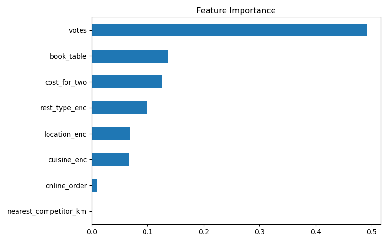
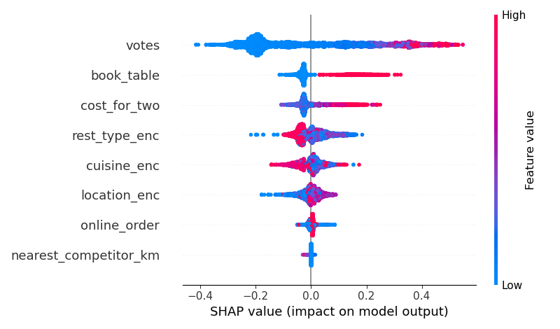

# Zomato Bangalore - Restaurant Market Gap Analysis

I built this project to answer a simple question: if someone wants to open a
new restaurant in Bangalore, where should they open it and what food should
they serve?

Most people just clean the Zomato dataset and make some charts. I wanted to
go further and actually find underserved areas using data.

## What I found

- Whitefield area has a gap for BBQ restaurants (gap score 0.855, the highest in the whole dataset)
- My model can predict if a restaurant will be highly rated with 91% accuracy
- I analyzed about 30,000 restaurants spread across 92 localities in Bangalore
- Restaurants with table booking have noticeably higher ratings (4.14 avg) than ones without (3.63 avg) - a much stronger signal than online ordering, which barely made a difference

## Folder structure

```
zomato-market-gap-project/
├── data/                       (raw and cleaned data files)
├── src/
│   ├── 01_clean_data.py        (cleans the raw data)
│   ├── 02_geocode.py           (adds lat/long for each area)
│   ├── 03_geospatial_eda.py    (heatmap + cuisine analysis)
│   ├── 04_market_gap_score.py  (finds the gap score for each area)
│   ├── 05_predict_success.py   (ML model to predict rating)
│   └── utils.py                (helper functions used in other scripts)
├── outputs/                    (charts, maps, and result files)
└── requirements.txt
```

## Some results

Feature importance from the model:


SHAP plot showing which features affect predictions:


There's also an interactive heatmap in `outputs/density_heatmap.html`.
It's an HTML file so it won't show up here on GitHub, you have to
download it and open it in your browser to see it properly.

## How to run this project

Install the requirements first:
```bash
pip install -r requirements.txt
```

Then run the scripts one by one, in this order:
```bash
python src/01_clean_data.py
python src/02_geocode.py
python src/03_geospatial_eda.py
python src/04_market_gap_score.py
python src/05_predict_success.py
```

Note: `02_geocode.py` takes a few minutes to run the first time because it
looks up coordinates for around 90 areas one at a time (there's a rate
limit of 1 request per second). After that it saves the results in a file
so you don't have to wait again next time.

## A problem I had to solve

The original dataset only has area names like "Koramangala" or
"Indiranagar" - no actual coordinates. So I couldn't do any map-based
analysis directly. I used the geopy library with Nominatim (OpenStreetMap)
to convert each area name into latitude/longitude, and saved it so the
geocoding only has to run once.

## What each script actually does

1. **01_clean_data.py** - fixes messy values in the ratings column (some were "NEW" or just "-"), removes duplicate rows, cleans up the cost column
2. **02_geocode.py** - adds real coordinates to each restaurant based on its area
3. **03_geospatial_eda.py** - makes a heatmap, checks how saturated each cuisine is per area, and calculates distance to the nearest competitor
4. **04_market_gap_score.py** - combines all of this into one score per area + cuisine combination, so I can rank the best opportunities. Also pulls in the most-liked dishes per area from the `dish_liked` column, and checks whether online ordering or table booking actually correlates with rating
5. **05_predict_success.py** - trains a Random Forest model to predict if a restaurant will be highly rated, and uses SHAP to explain why

## Final output

Check `outputs/recommendation_memo.md` - it lists the best area + cuisine
combinations for opening a new restaurant, along with popular dishes
already working in each area, and whether online ordering or table
booking actually matters for ratings.
